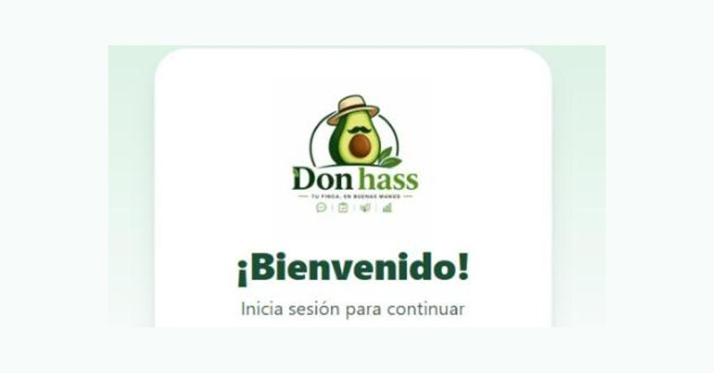

# Jerónimo Uribe Garcés

**Técnico en Programación de Software (SENA)** · Medellín, Colombia

Construyo aplicaciones web completas, de la base de datos a la pantalla, y las dejo funcionando en producción. Lidero un equipo de 5 programadores en Don Hass y tengo clientes reales como desarrollador independiente. Uso inteligencia artificial para automatizar tareas y entregar más rápido.

- Busco mi primer empleo formal en **desarrollo de software, IA y automatización o soporte técnico**, remoto o en Medellín.
- Me gradúo del SENA el **4 de diciembre de 2026**. Estoy cursando los bootcamps de **IA y Programación de EAFIT** (Estud-IA 2026).
- 📫 [LinkedIn](https://www.linkedin.com/in/jeronimo-uribe-garces-a1b4123b9/)

---

## Proyectos

> El código de estos proyectos es privado porque pertenece a clientes o maneja datos de usuarios. Puedo mostrarlo en una entrevista.

### Don Hass · Plataforma para fincas de aguacate Hass

Plataforma web para una asociación de productores de aguacate Hass. **Lidero el proyecto y un equipo de 5 programadores**: defino prioridades, reviso el código y respondo por la calidad de cada entrega.

- Digitaliza el registro diario de cada finca: labores, aplicaciones y cosechas.
- Genera solo el informe de auditoría trimestral (33 hojas de Excel) que antes se llenaba a mano.
- La información de cada finca queda aislada y protegida (seguridad a nivel de fila).

`Next.js` `React` `TypeScript` `Supabase (PostgreSQL)` `Railway` `pruebas automatizadas` `CI`

### MercaPlus · Plataforma para vendedores de Mercado Libre

Plataforma web (SaaS) para vendedores de Mercado Libre en Colombia. La desarrollé y la mantengo para un cliente comercial.

- La IA responde las preguntas de los compradores a cualquier hora.
- Calcula sola la ganancia de cada venta y reúne todo el negocio en un panel.
- Se conecta con la API de Mercado Libre: inicio de sesión OAuth y notificaciones en tiempo real.

`NestJS` `Prisma` `PostgreSQL` `Redis` `Next.js` `React` `Railway` · [mercaplus.netlify.app](https://mercaplus.netlify.app)

### Florín · Asistente financiero por WhatsApp con IA

La persona escribe sus gastos e ingresos como habla y Florín los registra, los organiza y le muestra resúmenes. Hoy lo usan unas 10 personas.

- Interpreta los mensajes con IA y guarda todo en base de datos y en Google Sheets.
- Los datos de cada usuario están separados y protegidos, con copias de respaldo y pruebas automáticas.

`Python` `FastAPI` `PostgreSQL` `WhatsApp (Twilio)` `Google Sheets API` `Railway`

### Velari Consultores · Sitio web corporativo

Sitio de una firma de consultores jurídicos en Medellín. Hice el diseño, el desarrollo y la publicación.

- Generador de sitio propio: todo el contenido vive en un solo archivo y el sitio se arma solo.
- Antes de publicar se revisan solos los enlaces rotos y el SEO; si algo falla, no se publica.

`JavaScript (Node.js)` `HTML` `CSS` `Docker` `Railway` `SEO` · [velariconsultores.com](https://velariconsultores.com)

---

## Herramientas

**Lenguajes:** Python · JavaScript · TypeScript · SQL
**Web:** React · Next.js · NestJS · FastAPI · Node.js
**Datos e infraestructura:** PostgreSQL · Supabase · Prisma · Redis · Docker · Railway · Git · GitHub Actions
**IA y automatización:** desarrollo asistido por IA · bots de WhatsApp · integración de APIs · Google Sheets API
**Soporte técnico:** mantenimiento y reparación de computadores (hardware y software)
